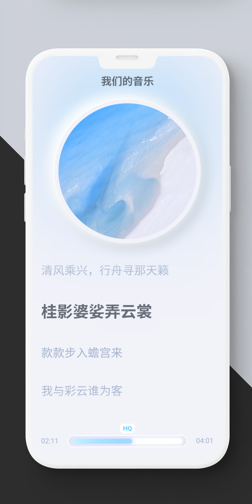
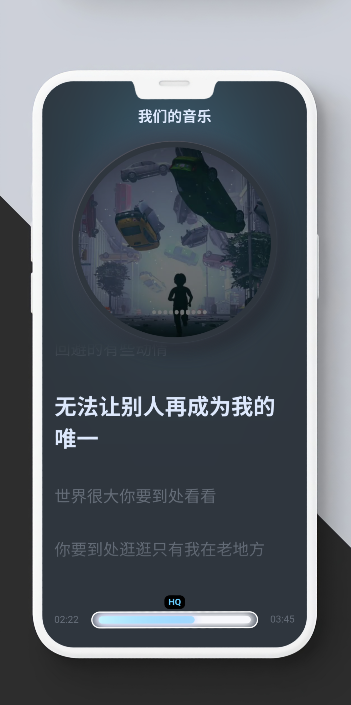
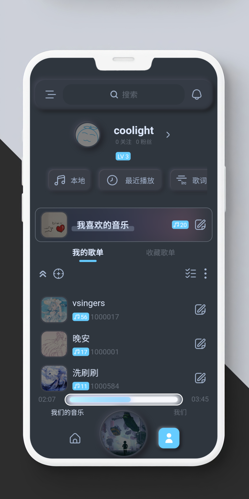
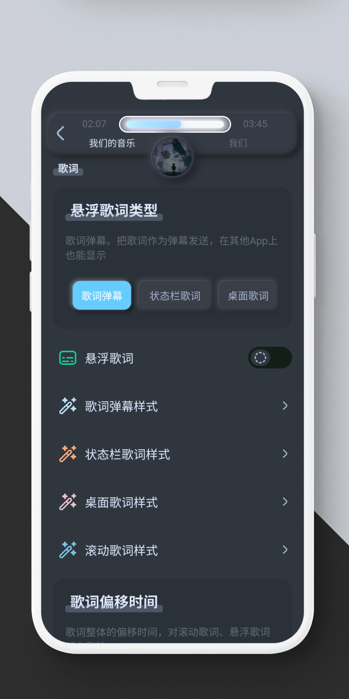
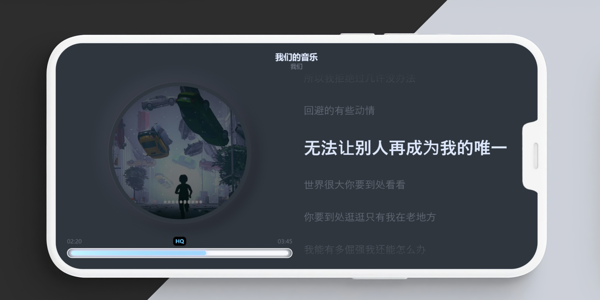

# Musicxx 拟声
* [官网](https://blog.music.bool.run/)
* [下载官网](https://download.music.bool.run/)
* [GitHub](https://github.com/coolight7/musicxx)

## 简介
* 本地/云盘/NAS全格式支持的音视频播放器
* 后端：
  * c++，基于搜狗开源的 [workflow](https://github.com/sogou/workflow) 开发
  * workflow 的任务流设计能把回调也变得简单易懂，c++中不可多得的异步框架，跨平台；支持 http、rpc、mysql 等网络开发和计算任务调度，你值得拥有！
* 客户端：
  * flutter
  * 支持[安卓]、[iPhone]、[windows]、[mac]、[linux]；允许多端同时登录账号，并将自动同步 歌单、歌词、webdav连接 等
  * 支持播放 bili 歌曲、本地歌曲、音乐文件链接、webdav、阿里云盘、百度云盘、115云盘、Subsonic、Jellyfin、Emby 
  * 支持播放绝大多数音视频格式；支持视频MV、Anime4K 实时画质提升、逐帧播放
  * 支持`歌词弹幕、状态栏歌词、桌面歌词`，高容错的歌词解析能力，支持歌词制作、显示翻译歌词等
  * 新拟物风格主题，并支持 跟随系统、跟随时间 切换；支持自定义背景图、天气背景、动态渐变色、晶格化
  * 丰富的自定义功能：真/伪随机播放、自定义App启动位置、启动时自动播放、方形封面、网格布局
  * `共享与控制`：可在多个设备之间共享本地、云盘歌曲，并远程控制
  * `同步歌单音源`：自动拉取绑定的本地歌曲/webdav/云盘音源，更新添加到歌单中
  * `智能识别`：自动从bili标题中识别歌曲标题、歌手，并支持歌手、专辑分类时自动关联简写名、繁简体、错拼名等
- 已开源的开发拟声时的库:
  - [musicxx_extern_plugin](https://github.com/coolight7/musicxx_extern_plugin):
    - 拟声的外置插件框架，支持 动态加载 C++动态库插件、JS脚本插件、shader着色器渲染
    - 如果需要自定义实现插件，请参考该框架文档，以及里面的示例插件
  - [agentxx](https://github.com/coolight7/agentxx):
    - C++实现的高性能 AI Agent，摆脱复杂庞大的依赖库和运行环境，体积小的同时速度快内存占用低，Win端运行时仅需3MB内存! 
    - 嵌入 app 中，辅助实现各种 agent 功能，以及提供外置插件基础框架支持
  - [mediaxx](https://github.com/coolight7/mediaxx): 
    - 融合编译 ffmpeg/libmpv, 一个程序中如果需要打包 ffmpeg、libmpv 以及自己开发的音频处理库，分开编译会有很多依赖库代码是重复的，`mediaxx`合并编译成一个库，并控制导出符号，可以减少动态/静态链接混合等问题且大幅缩减体积 (musicxx从63MB->40MB; lumenxx从140MB->50MB)
    - 读取音视频文件的基本信息、封面、结合uchardet、iconv尝试识别字符串的字符编码格式转换到 utf8、分析图片颜色
  - [lyric_xx](https://github.com/coolight7/lyric_xx): 
    - 超高兼容性的 lrc 编解码库，由于 LRC 歌词鱼龙混杂，我们开发了 `lyric_xx` 用于尽力兼容各种 LRC 标准和非标准格式
    - 支持解析 逐行LRC、增强型LRC、同时间戳/无时间戳的翻译歌词、允许歌词行乱序、前后置时间戳、一行多时间戳、一行多句歌词 等
  - [string_util_xx](https://github.com/coolight7/string_util_xx)
    - 字符串处理工具；中文拼音排序，数值比较排序（1,2,3,11,12,123...），移除空白符号，忽略大小写比较

## 预览图
| -                                | -                                  | -                                  | -                                  | -                                  |
| -------------------------------- | ---------------------------------- | ---------------------------------- | ---------------------------------- | ---------------------------------- |
|  |  |  |  |  |

## 支持平台：
- android (安卓4.1及以上，arm64-v8a/armeabi-v7a/x86_64) 手机、车机、电视、平板
- iPhone（ios13以以上，arm64）
- windows (Win10及以上，x86_64)
- macos（Macos11及以上，arm64）
- linux（x86_64）