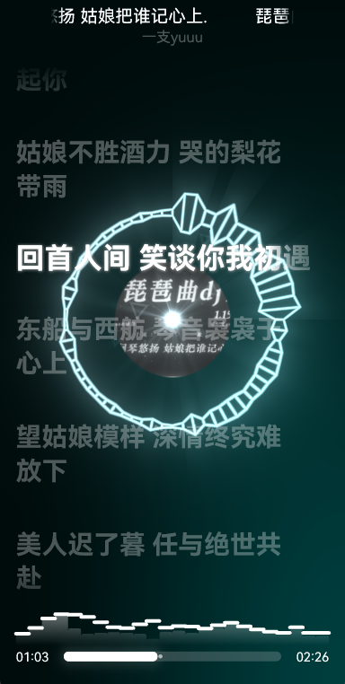

# 开发外部插件
- 在拟声 `v0.90.0` 开始支持 外部插件框架，用户可以自定义开发、安装插件

## AI全自动许愿
- 推荐直接跟 AI Agent 说明你的需求，由 AI 自动开发插件，简单省事不烧心
- 比如:
```txt
参考 [musicxx_extern_plugin](https://github.com/coolight7/musicxx_extern_plugin) ，请帮我写一个拟声插件，实现 在拟声启动时弹出一条提示`哈基米！`，仔细思考分析后实现，并打包给我插件压缩安装包
```

## 文档
- 见 Github 外部插件框架 [musicxx_extern_plugin](https://github.com/coolight7/musicxx_extern_plugin)；里面包含了 插件框架源码、示例插件、已实现的插件 API文档、拟声的 MCP接口、AppLink、main启动参数、Http Server 等文档说明
- 如果有需要增加的插件接口请联系我们

## 示例插件
- 示例插件并不适合长期安装日常使用，它仅作为演示功能实现，包含了很多调试和开发说明，可以安装尝鲜看看效果，具体需求应当自行开发修改或使用AI
- [example_js_font](https://lumenxx.lanzoub.com/iPzA64bxgb5g) 演示自定义更换字体

- [example_js_shader](https://lumenxx.lanzoub.com/inCFn4bxgaqb) 演示通过着色器自定义渲染播放页面背景，以及接收`内置插件/音乐动效`产生的音频频谱，实现音频可视化

- [playing_bg_image](https://lumenxx.lanzoub.com/iBXqL4bxgb7i) 演示通过着色器、取当前歌曲封面实现自定义播放页面背景沉浸、模糊、仿黑胶唱片


